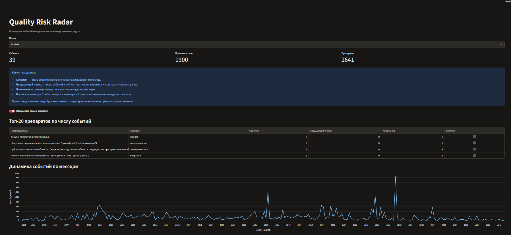

# Quality Risk Radar

**Quality Risk Radar** — аналитический дашборд для мониторинга событий контроля качества лекарственных средств на основе открытых данных Росздравнадзора.

Проект помогает быстро находить препараты и производителей, у которых в выбранном месяце наблюдается рост числа негативных событий.



## Бизнес-задача

Аналитику качества или специалисту по закупкам нужно быстро понять:

- какие препараты чаще всего попадают в события контроля качества;
- какие производители генерируют больше всего событий;
- где наблюдается резкий рост активности по сравнению с предыдущим месяцем;
- какие объекты стоит проверить в первую очередь.

Проект не предсказывает недоброкачественность и не заменяет регуляторные решения. Он формирует приоритетный список объектов для дополнительного внимания.

## Данные

Источник данных — открытый набор Росздравнадзора:

[Сведения об осуществлении государственного контроля качества лекарственных средств](https://roszdravnadzor.gov.ru/opendata/7710537160-drugs_qualitycontrol)

Основные поля:

- препарат;
- регистрационное удостоверение;
- серия;
- производитель;
- страна производителя;
- статус контроля;
- тип действия;
- номер и дата информационного письма.

## Что показывает дашборд

- Общее число событий за выбранный месяц.
- Число затронутых производителей и препаратов.
- Топ-20 препаратов по числу событий.
- Изменение числа событий относительно предыдущего месяца.
- Пометку «всплеск».
- Динамику событий по месяцам.
- Детали по выбранному производителю и препарату.

## Как читать таблицу

| Поле | Значение |
|---|---|
| `События` | Число событий контроля качества в выбранном месяце |
| `Предыдущий месяц` | Число событий месяцем ранее |
| `Изменение` | Разница между текущим и предыдущим месяцем |
| `Всплеск` | Минимум 3 события и рост минимум в 2 раза |

## ML-модель

Построена простая модель бинарной классификации для приоритизации
пар «производитель + препарат» по вероятности появления события
контроля качества в следующем месяце.

Целевая переменная:

```text
target_next_month
```

- `1` — в следующем месяце у пары будет хотя бы одно событие;
- `0` — событий в следующем месяце не будет.

Модель использует только исторические признаки:

- число событий в текущем месяце;
- число серий;
- число информационных писем;
- число событий в предыдущем месяце;
- изменение относительно предыдущего месяца;
- признак всплеска.

Данные разделены по времени: первые 80% месяцев используются для обучения, последние 20% — для тестирования. Случайное разбиение не применяется, чтобы избежать утечки информации из будущего.

## Результаты модели

| Метод | Precision@20 |
|---|---:|
| Baseline: текущие события | 0.40 |
| ML-модель | 0.60 |

ROC-AUC модели на отложенном периоде: **0.681**.

Модель повышает Precision@20 с 0.40 до 0.60. Это означает, что среди 20 объектов с наивысшим прогнозом 12 действительно получают событие в следующем месяце, тогда как у baseline таких объектов 8.

## Интерпретация метрик

В тестовой выборке только 814 будущих событий из 270,400 строк. Поэтому accuracy не является основной метрикой: она будет высокой даже у модели, которая всегда предсказывает отсутствие события.

Для этой задачи наиболее полезна метрика **Precision@20**:

```text
Из топ-20 объектов, отобранных моделью,
12 действительно получают событие в следующем месяце.
```

Recall при стандартном пороге 0.5 составляет 6%. Это ожидаемо при сильном дисбалансе классов: модель не пытается найти все события, а формирует короткий приоритетный список для дополнительного анализа.

## Ограничения ML-модели

- Модель не предсказывает недоброкачественность препарата.
- Модель не заменяет регуляторные решения.
- Высокая вероятность события не доказывает наличие проблемы с качеством.
- Результаты могут меняться при обновлении данных.
- Для продакшена требуется регулярная перепроверка качества модели на новых периодах.

## Как запустить

```powershell
git clone [https://github.com/SleX624/quality-risk-radar.git](https://github.com/SleX624/quality-risk-radar.git)
cd quality-risk-radar

python -m venv .venv
.\.venv\Scripts\Activate.ps1

pip install -r requirements.txt

streamlit run app.py
```

После запуска откройте в браузере:

```text
http://127.0.0.1:8501
```

## Структура проекта

```text
quality-risk-radar/
├── data/
│   ├── raw/
│   └── processed/
├── notebooks/
├── reports/
├── src/
├── app.py
├── README.md
└── requirements.txt
```

## Ограничения

- Проект использует открытые данные и предназначен для аналитической приоритизации.
- Он не является медицинским, юридическим или регуляторным заключением.
- Высокое число событий не доказывает недоброкачественность препарата.
- Названия производителей и препаратов могут иметь вариации; нормализация выполняется эвристически.

## Возможные развития

- Автоматическое обновление данных по расписанию.
- Фильтры по стране, статусу и типу действия.
- Экспорт топа риска в Excel.
- Сравнение с историческим профилем производителя.
- ML-модель для приоритизации объектов.